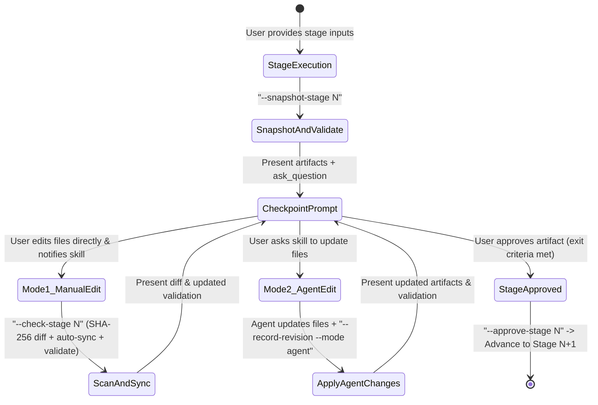

# Checkpoint & Dual-Mode Revision Loop Protocol (`act-production-orchestrator`)

This reference defines the exact inline notification templates, proactive step-input prompts, and **Dual-Mode Revision Loop** mechanics for all 5 checkpoints in the Act Production Orchestrator.

---

## 1. The Dual-Mode Revision Loop State Machine

At every stage checkpoint (`Checkpoint 1` through `Checkpoint 5`), execution pauses and enters an interactive revision loop:

### Rules of the Revision Loop
1. **Unlimited Multi-Mode Iterations**: A single checkpoint can loop 0, 1, or $k$ times, switching freely between **Mode 1 (Manual File Edit)** and **Mode 2 (Agent-Assisted Edit)** on each iteration.
2. **Automatic Paired-File Synchronization on Manual Edits**:
   - **Checkpoint 1 (`<Act>_Story_Writeup.md`)**: When the user manually edits the writeup markdown file, `--check-stage 1` verifies that all target phonics words and speaker lines are present, and Stage 3 uses the user's updated writeup verbatim.
   - **Checkpoint 2 (`_flow_bw.png` / `_flow_color.png`)**: If the user manually edits a `_flow_bw.png` file, the agent offers to re-run deterministic flood-fill colorization so `_flow_color.png` stays 100% pixel-locked to the updated B&W line art.
   - **Checkpoint 3 (`<Act>_Screenplay.txt` ⇄ `<act>_screenplay.json`)**: If the user manually edits `<Act>_Screenplay.txt`, `--check-stage 3` automatically parses updated `[Narrator]: "..."`, `[Clem]: "..."`, and `[Plum]: "..."` lines and syncs them into `<act>_screenplay.json`, then re-runs `evaluate_screenplay.py` across all 5 gates.
   - **Checkpoint 4 (`*.wav` ⇄ `manifest.json`)**: If the user manually replaces `.wav` files in `output/audio/<act>_vo/`, `--check-stage 4` recalculates exact WAV durations and cumulative scene offsets in `manifest.json`. If the user edits utterance text in `<act>_screenplay.json`, re-running `synthesize_human_narration.py` uses WAV caching to synthesize only the modified line(s).
   - **Checkpoint 5 (`<Act>_Animation.mp4`)**: If only audio or narration timing changes during Checkpoint 5 revisions, invoke `mux_narration_into_mp4.swift` to losslessly replace the audio track in ~2 seconds without re-rendering video frames.

---

## 2. Standard Inline Notification Banners

Use these concise markdown banners in chat to keep the user informed inline at every transition:

- **Stage Start Banner**:
  > **[Stage `N`/5 — `<Stage Name>`] Starting...**
  > - **Skill(s) Invoked**: `<skill-name>`
  > - **Inputs Locked**: `
`
  > - **Target Output(s)**: `<clickable file paths>`

- **Checkpoint Review Banner**:
  > ### 🛑 Checkpoint `N`/5 Ready for Review — `<Stage Name>`
  > - **Validation Status**: `PASS` (Revision Loop Iteration `#<k>`)
  > - **Artifacts to Review**:
  >   - [`<filename>`](file:///absolute/path)
  > - **How to Revise or Approve**:
  >   1. **Approve**: Select **Approve** in the prompt to lock these artifacts and advance to Stage `N+1`.
  >   2. **Mode 1 (Manual File Edit)**: Edit any of the linked files directly in your editor, save, and select *"I manually updated the file(s)"*.
  >   3. **Mode 2 (Agent-Assisted Edit)**: Tell me what to change (either via the prompt write-in or in chat) and I will update the files and re-validate for you.

---

## 3. Standard `ask_question` Modal Templates

### Stage 0 Kickoff Prompt
- **Question 1**: *"Which Act and setting would you like to produce, and which 5 target phonics words should we feature?"*
  - `(Recommended) Use the next Act from story_draft_prompts.txt and lock Clem & Plum's character sheet`
  - `Let me specify a custom Act title, setting, and target word list`
  - `Use theme-word-generator to propose 5 phonics words for my chosen theme first`

### Checkpoint `N` Loop Prompt (`N = 1..5`)
- **Question**: *"Checkpoint N/5 (<Stage Name>): How would you like to proceed with these artifacts?"*
  - `(Recommended) Approve artifacts & proceed to the next stage`
  - `I manually edited the file(s) directly — scan, sync, and re-validate my changes (Mode 1)`
  - `Update the artifacts for me based on my instructions (Mode 2)`
